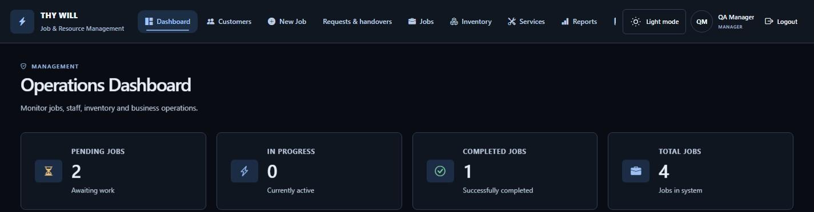
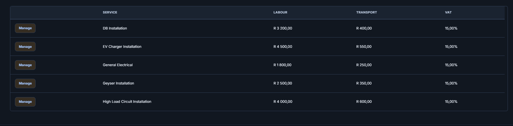
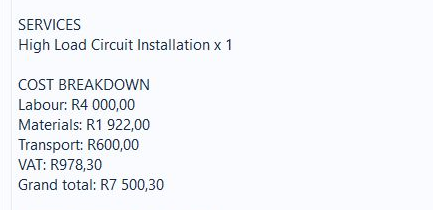

# THY WILL | Job and resource management

THY WILL is a two-semester team capstone for an electrical and construction business. It connects the customer's booking, the technician's work and the manager's invoice to one job record. A Windows desktop application and an ASP.NET customer and staff portal share business rules and SQL Server data.

[Open the Azure website](https://ist-wst-group-34-evfsa0bcctd3acab.southafricanorth-01.azurewebsites.net/) · [Watch or download the 24-second screenshot walkthrough (MP4)](docs/demo/thy-will-walkthrough.mp4)

The website runs on a university subscription. The walkthrough shows the manager workspace, service catalogue, saved job total and invoice actions. It can be viewed without an account.

## From booking to payment

1. A customer requests electrical work. Staff select the service, review the promise date and assign an available technician.
2. The manager checks stock and material requirements. The job retains its labour, transport and material costs so staff can explain the quoted total.
3. Technicians view assigned jobs. Managers handle handovers, review changes and decide cancellation requests.
4. Staff can open the invoice and collect cash for an eligible unpaid job. Payment checks prevent a second settlement. A receipt records the successful payment.

## Screenshots

The operations dashboard groups jobs by status so a manager can choose which bookings need attention.

Transport depends on the service. The catalogue shows R250 for General Electrical and R600 for High Load Circuit Installation. Both use 15% VAT.

For this High Load Circuit Installation, R4,000 labour, R600 transport and R1,922 materials give a subtotal of R6,522. VAT of R978.30 brings the saved total to **R7,500.30**.

## Architecture and contributions

| Component | Responsibility |
| --- | --- |
| Windows Forms desktop client | Staff workflows for bookings, job management, inventory and payments |
| ASP.NET Web Forms portal | Customer self-service and role-specific staff workspaces |
| Business services | Pricing, validation, authentication and payment rules shared across workflows |
| Data access and SQL Server | Persistence for accounts, bookings, material allocations, invoices and payments |

Lerato Mbhele built the manager workspace and worked on transaction processing, system administration, validation and layered architecture. Security work included salted PBKDF2 password verification, role-based access checks and customer ownership checks for invoices. The [regression checks](Verification/SystemRegressionTests.cs) include booking validation and payment input cases.

## Development setup

Open `Major_Project.sln` in Visual Studio on Windows with the .NET desktop and ASP.NET workloads, the .NET Framework 4.7.2 targeting pack and NuGet package restore enabled. Select `Major_Project` for the desktop client or `MajorProject.Web` for the web portal.

The applications require a compatible SQL Server database. The [database scripts](MajorProject.Web/Database) extend an existing application schema. A fresh SQL Server instance also needs the base schema. Supply your own connection settings for each client. Mail delivery and embedded reporting require separately configured provider settings.

In the public source, the connection strings target a local database named `ThyWill` using Windows authentication. For a hosted instance, configure the connection through the hosting environment. The desktop report viewer reads `THYWILL_POWERBI_URL`. Keep institution-issued credentials in private deployment settings.
